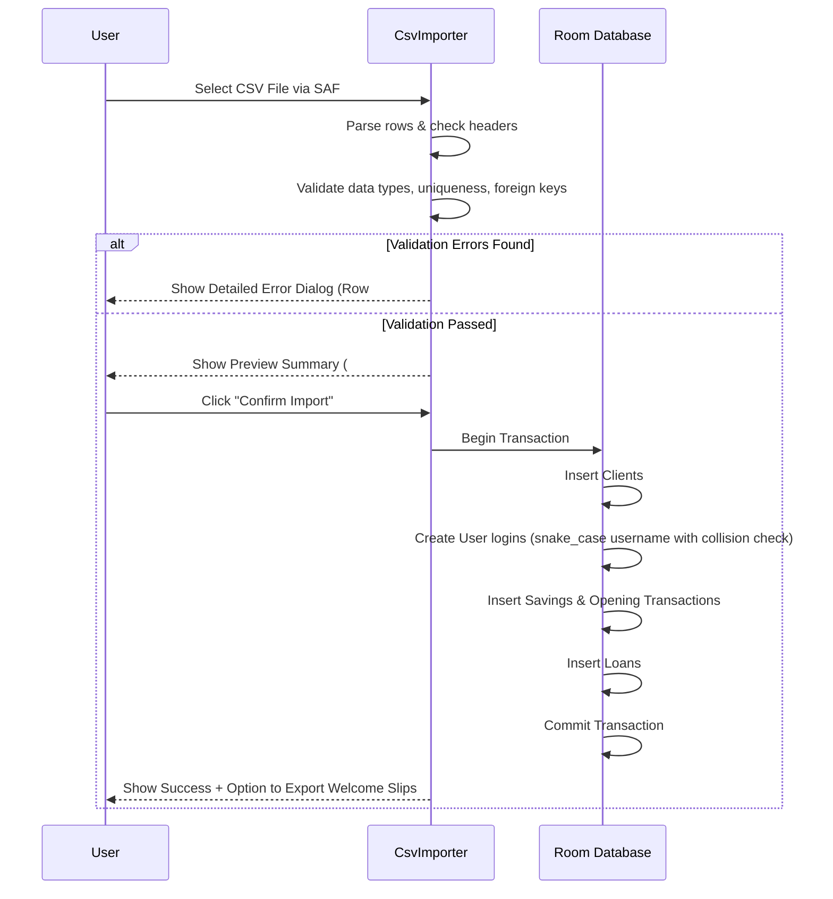

# FinanceApp — Complete System Architecture & Implementation Guide

> **Audience**: AI models (including compact/fast models like Gemini 1.5/2.0 Flash) and human developers implementing or maintaining this application.
> **Status**: Approved Blueprint — Ready for Execution.
> **Target Platform**: Android (Min SDK 24, Target SDK 36, Kotlin 2.x, Jetpack Compose, Navigation 3, Room SQLite).

---

## Table of Contents
1. [Executive Summary & Current State Baseline](#1-executive-summary--current-state-baseline)
2. [Target Architecture Overview](#2-target-architecture-overview)
3. [Database Schemas & Migrations](#3-database-schemas--migrations)
4. [Security & Authentication Engine](#4-security--authentication-engine)
5. [Role-Based Access Control (RBAC) & Member Portal](#5-role-based-access-control-rbac--member-portal)
6. [Group Fund & Banking Management](#6-group-fund--banking-management)
7. [CSV Export Specifications (10 Financial Reports)](#7-csv-export-specifications-10-financial-reports)
8. [CSV Import Engine (Bulk Onboarding)](#8-csv-import-engine-bulk-onboarding)
9. [Dual Encrypted Backup & Restore (.apex Specification)](#9-dual-encrypted-backup--restore-apex-specification)
10. [UI & Navigation Architecture (Navigation 3)](#10-ui--navigation-architecture-navigation-3)
11. [Dependencies & Manifest Configuration](#11-dependencies--manifest-configuration)
12. [Step-by-Step Implementation Roadmap & Checklists](#12-step-by-step-implementation-roadmap--checklists)

---

## 1. Executive Summary & Current State Baseline

### 1.1 Existing Functionality
The application is currently an offline Android finance manager designed for group/microfinance operators.
- **Data Layer**: Room DB (`finance_database.db`, version 6 with `fallbackToDestructiveMigration()`).
- **Entities**:
  - `Client` (`id`, `clientId`, `name`, `phoneNumber`, `address`, `createdAt`)
  - `SavingsAccount` (`id`, `clientId`, `accountNumber`, `balance`, `createdAt`)
  - `SavingsTransaction` (`id`, `accountId`, `amount`, `type`, `description`, `transactionDate`, `timestamp`)
  - `Loan` (`id`, `clientId`, `guarantorId`, `amount`, `interestRate`, `tenureMonths`, `outstandingBalance`, `status`, `loanDate`, `createdAt`)
  - `LoanRepayment` (`id`, `loanId`, `amount`, `principalPaid`, `interestPaid`, `timestamp`)
- **Key Business Rules**:
  - A guarantor cannot borrow while an active guaranteed loan exists.
  - A borrower cannot self-guarantee.
  - A member can guarantee at most one active loan.
  - 80% combined savings cap for loan disbursements (`amount <= 0.8 * (borrower_savings + guarantor_savings)`).
  - Flat interest rate calculation with accrued interest computed at runtime (`Loan.currentOutstandingBalance()`).
- **UI / Navigation**: Jetpack Compose (Material 3), Navigation 3 (`NavDisplay`, `rememberNavBackStack`, `entryProvider`).
- **Backup**: Simple unencrypted SQLite file copy using Android Storage Access Framework (SAF).

### 1.2 Gaps to be Implemented
1. **Zero Authentication**: Anyone opening the app has unrestricted administrative access.
2. **Missing Roles**: No distinction between Group Admins and individual Members.
3. **No Member Portal**: Members cannot log in to inspect only their personal loans and savings balances.
4. **No Group Account Tracking**: No central ledger for group physical cash on hand vs. commercial bank balance.
5. **No Financial Reporting / Export**: Missing CSV exports for annual general meetings (AGMs), audit trails, loan books, and balance sheets.
6. **No Data Import**: Missing CSV bulk import for onboarding existing group records.
7. **Insecure Data & Backups**: Database is unencrypted SQLite on device; backups are plain `.db` files vulnerable to inspection.
8. **No Cloud Sync Option**: No Google Drive encrypted backup/restore.

---

## 2. Target Architecture Overview

The system follows an offline-first **Clean MVVM** pattern with strict security boundaries:

```
┌─────────────────────────────────────────────────────────────┐
│                       Presentation Layer                    │
│  Compose UI Screens (M3) + Navigation 3 Type-Safe Backstack │
├─────────────────────────────────────────────────────────────┤
│                         Session Layer                       │
│  SessionManager (StateFlow<UserSession?>) + AuthViewModel   │
│  - In-memory credentials, Auto-logout timer (5 min idle)    │
│  - Role verification guard for navigation entry points      │
├─────────────────────────────────────────────────────────────┤
│                        ViewModel Layer                      │
│  BankViewModel (Admin domain) | MemberViewModel (Filtered)  │
│  ReportsViewModel             | BackupRestoreViewModel      │
├─────────────────────────────────────────────────────────────┤
│                       Repository Layer                      │
│  BankRepository | UserRepository | GroupFundRepository     │
│  CsvEngine      | BackupCryptoEngine | GoogleDriveClient    │
├─────────────────────────────────────────────────────────────┤
│                        Database Layer                       │
│  Room with SQLCipher (256-bit AES) + Migrations             │
│  Entities: Client, Savings, Loan, User, GroupFund, AuditLog │
└─────────────────────────────────────────────────────────────┘
```

---

## 3. Database Schemas & Migrations

### 3.1 New Entities

#### Entity: `User` (`users` table)
Stores credentials and authorization for both Admins and Members.
```kotlin
package com.example.financeapp.database.entities

import androidx.room.Entity
import androidx.room.ForeignKey
import androidx.room.Index
import androidx.room.PrimaryKey

@Entity(
    tableName = "users",
    foreignKeys = [
        ForeignKey(
            entity = Client::class,
            parentColumns = ["id"],
            childColumns = ["clientId"],
            onDelete = ForeignKey.SET_NULL
        )
    ],
    indices = [
        Index(value = ["username"], unique = true),
        Index(value = ["clientId"], unique = true)
    ]
)
data class User(
    @PrimaryKey(autoGenerate = true) val id: Long = 0,
    val username: String,             // Unique login handle
    val passwordHash: String,         // Argon2id / PBKDF2 hash
    val salt: String,                 // 16-byte hex-encoded random salt
    val role: String,                 // "ADMIN" or "MEMBER"
    val clientId: Long? = null,       // Linked Client ID (null for pure admins)
    val isActive: Boolean = true,
    val failedAttempts: Int = 0,      // Max 5 before temporary lock
    val lockedUntil: Long? = null,    // Lockout epoch timestamp (millis)
    val mustChangePassword: Boolean = true, // Force change on first login
    val createdAt: Long = System.currentTimeMillis(),
    val lastLoginAt: Long? = null
)
```

#### Entity: `GroupAccount` (`group_accounts` table)
Singleton-style tracking of the collective fund.
```kotlin
package com.example.financeapp.database.entities

import androidx.room.Entity
import androidx.room.PrimaryKey

@Entity(tableName = "group_accounts")
data class GroupAccount(
    @PrimaryKey val id: Long = 1,     // Fixed single row ID
    val name: String = "Group Treasury",
    val cashBalance: Double = 0.0,    // Cash on hand in treasury box
    val bankBalance: Double = 0.0,    // Balance in commercial bank account
    val bankName: String = "",
    val bankAccountNumber: String = "",
    val lastUpdated: Long = System.currentTimeMillis()
)
```

#### Entity: `GroupTransaction` (`group_transactions` table)
Double-entry ledger for group-level inflows and outflows.
```kotlin
package com.example.financeapp.database.entities

import androidx.room.Entity
import androidx.room.Index
import androidx.room.PrimaryKey

@Entity(
    tableName = "group_transactions",
    indices = [
        Index("transactionDate"),
        Index("relatedClientId"),
        Index("relatedLoanId")
    ]
)
data class GroupTransaction(
    @PrimaryKey(autoGenerate = true) val id: Long = 0,
    val type: String,                 // See GroupTxType enum below
    val amount: Double,               // Always positive decimal
    val channel: String,              // "CASH" or "BANK"
    val description: String,
    val relatedClientId: Long? = null,
    val relatedLoanId: Long? = null,
    val relatedSavingsAccountId: Long? = null,
    val recordedByUserId: Long,
    val transactionDate: Long = System.currentTimeMillis(),
    val createdAt: Long = System.currentTimeMillis()
)

enum class GroupTxType {
    SAVINGS_DEPOSIT,      // Inflow (+)
    SAVINGS_WITHDRAWAL,   // Outflow (-)
    LOAN_DISBURSEMENT,    // Outflow (-)
    LOAN_REPAYMENT,       // Inflow (+) (splits into principal + interest)
    INTEREST_INCOME,      // Income earned from bank deposit or penalties
    EXPENSE,              // Outflow: stationery, refreshments, audit fees
    BANK_DEPOSIT,         // Transfer: Cash -> Bank (Net 0)
    BANK_WITHDRAWAL       // Transfer: Bank -> Cash (Net 0)
}
```

#### Entity: `AuditLog` (`audit_logs` table)
Immutable log of administrative operations for auditing and compliance.
```kotlin
package com.example.financeapp.database.entities

import androidx.room.Entity
import androidx.room.Index
import androidx.room.PrimaryKey

@Entity(
    tableName = "audit_logs",
    indices = [Index("timestamp"), Index("userId")]
)
data class AuditLog(
    @PrimaryKey(autoGenerate = true) val id: Long = 0,
    val userId: Long,
    val username: String,
    val action: String,               // e.g. "USER_LOGIN", "DISBURSE_LOAN", "CSV_EXPORT"
    val details: String,              // Human-readable summary or JSON details
    val timestamp: Long = System.currentTimeMillis()
)
```

### 3.2 Migration Strategy: Version 6 to Version 7
> [!CRITICAL]
> **Remove `.fallbackToDestructiveMigration()` immediately** from `AppDatabase.kt`.
> Add explicit `Migration(6, 7)` to preserve all existing client, loan, and savings data.

```kotlin
val MIGRATION_6_7 = object : Migration(6, 7) {
    override fun migrate(db: SupportSQLiteDatabase) {
        // 1. Create users table
        db.execSQL("""
            CREATE TABLE IF NOT EXISTS `users` (
                `id` INTEGER PRIMARY KEY AUTOINCREMENT NOT NULL,
                `username` TEXT NOT NULL,
                `passwordHash` TEXT NOT NULL,
                `salt` TEXT NOT NULL,
                `role` TEXT NOT NULL,
                `clientId` INTEGER,
                `isActive` INTEGER NOT NULL DEFAULT 1,
                `failedAttempts` INTEGER NOT NULL DEFAULT 0,
                `lockedUntil` INTEGER,
                `mustChangePassword` INTEGER NOT NULL DEFAULT 1,
                `createdAt` INTEGER NOT NULL,
                `lastLoginAt` INTEGER,
                FOREIGN KEY(`clientId`) REFERENCES `clients`(`id`) ON UPDATE NO ACTION ON DELETE SET_NULL
            )
        """.trimIndent())
        db.execSQL("CREATE UNIQUE INDEX IF NOT EXISTS `index_users_username` ON `users` (`username`)")
        db.execSQL("CREATE UNIQUE INDEX IF NOT EXISTS `index_users_clientId` ON `users` (`clientId`)")

        // 2. Create group_accounts table and initialize default row
        db.execSQL("""
            CREATE TABLE IF NOT EXISTS `group_accounts` (
                `id` INTEGER PRIMARY KEY NOT NULL,
                `name` TEXT NOT NULL,
                `cashBalance` REAL NOT NULL,
                `bankBalance` REAL NOT NULL,
                `bankName` TEXT NOT NULL,
                `bankAccountNumber` TEXT NOT NULL,
                `lastUpdated` INTEGER NOT NULL
            )
        """.trimIndent())
        db.execSQL("""
            INSERT OR IGNORE INTO `group_accounts` (`id`, `name`, `cashBalance`, `bankBalance`, `bankName`, `bankAccountNumber`, `lastUpdated`)
            VALUES (1, 'Main Group Treasury', 0.0, 0.0, '', '', ${System.currentTimeMillis()})
        """.trimIndent())

        // 3. Create group_transactions table
        db.execSQL("""
            CREATE TABLE IF NOT EXISTS `group_transactions` (
                `id` INTEGER PRIMARY KEY AUTOINCREMENT NOT NULL,
                `type` TEXT NOT NULL,
                `amount` REAL NOT NULL,
                `channel` TEXT NOT NULL,
                `description` TEXT NOT NULL,
                `relatedClientId` INTEGER,
                `relatedLoanId` INTEGER,
                `relatedSavingsAccountId` INTEGER,
                `recordedByUserId` INTEGER NOT NULL,
                `transactionDate` INTEGER NOT NULL,
                `createdAt` INTEGER NOT NULL
            )
        """.trimIndent())
        db.execSQL("CREATE INDEX IF NOT EXISTS `index_group_transactions_transactionDate` ON `group_transactions` (`transactionDate`)")

        // 4. Create audit_logs table
        db.execSQL("""
            CREATE TABLE IF NOT EXISTS `audit_logs` (
                `id` INTEGER PRIMARY KEY AUTOINCREMENT NOT NULL,
                `userId` INTEGER NOT NULL,
                `username` TEXT NOT NULL,
                `action` TEXT NOT NULL,
                `details` TEXT NOT NULL,
                `timestamp` INTEGER NOT NULL
            )
        """.trimIndent())
        db.execSQL("CREATE INDEX IF NOT EXISTS `index_audit_logs_timestamp` ON `audit_logs` (`timestamp`)")
    }
}
```

---

## 4. Security & Authentication Engine

### 4.1 Cryptographic Password Hashing
To maintain 100% offline security without heavy JNI runtime crashes on varied CPU architectures, use **PBKDF2WithHmacSHA256** with high iterations or **Argon2id**.
PBKDF2 is built directly into Android's `javax.crypto` without any external C++ binaries:

```kotlin
package com.example.financeapp.auth

import java.security.SecureRandom
import javax.crypto.SecretKeyFactory
import javax.crypto.spec.PBEKeySpec
import android.util.Base64

object PasswordHasher {
    private const val ITERATIONS = 120_000
    private const val KEY_LENGTH = 256
    private const val SALT_BYTES = 16

    fun generateSalt(): String {
        val random = SecureRandom()
        val salt = ByteArray(SALT_BYTES)
        random.nextBytes(salt)
        return Base64.encodeToString(salt, Base64.NO_WRAP)
    }

    fun hashPassword(password: String, saltHex: String): String {
        val salt = Base64.decode(saltHex, Base64.NO_WRAP)
        val spec = PBEKeySpec(password.toCharArray(), salt, ITERATIONS, KEY_LENGTH)
        val factory = SecretKeyFactory.getInstance("PBKDF2WithHmacSHA256")
        val hash = factory.generateSecret(spec).encoded
        return Base64.encodeToString(hash, Base64.NO_WRAP)
    }

    fun verifyPassword(password: String, salt: String, expectedHash: String): Boolean {
        val calculated = hashPassword(password, salt)
        return slowEquals(calculated.toByteArray(), expectedHash.toByteArray())
    }

    // Constant-time comparison to prevent timing attacks
    private fun slowEquals(a: ByteArray, b: ByteArray): Boolean {
        var diff = a.size xor b.size
        for (i in a.indices) {
            if (i < b.size) diff = diff or (a[i].toInt() xor b[i].toInt())
        }
        return diff == 0
    }
}
```

### 4.2 Account Lockout & Brute-Force Defense
- **Maximum Failed Attempts**: 5.
- **Lockout Duration**: 15 minutes (`System.currentTimeMillis() + 15 * 60 * 1000`).
- **Reset**: Successful login resets `failedAttempts = 0` and `lockedUntil = null`.

### 4.3 In-Memory Session Management (`SessionManager`)
```kotlin
package com.example.financeapp.auth

import kotlinx.coroutines.flow.MutableStateFlow
import kotlinx.coroutines.flow.StateFlow
import kotlinx.coroutines.flow.asStateFlow

data class UserSession(
    val userId: Long,
    val username: String,
    val role: String, // "ADMIN" or "MEMBER"
    val clientId: Long?,
    val tokenIssuedAt: Long = System.currentTimeMillis()
)

object SessionManager {
    private val _currentSession = MutableStateFlow<UserSession?>(null)
    val currentSession: StateFlow<UserSession?> = _currentSession.asStateFlow()

    fun startSession(session: UserSession) {
        _currentSession.value = session
    }

    fun clearSession() {
        _currentSession.value = null
    }

    fun isLoggedIn(): Boolean = _currentSession.value != null
    fun isAdmin(): Boolean = _currentSession.value?.role == "ADMIN"
    fun isMember(): Boolean = _currentSession.value?.role == "MEMBER"
    fun getCurrentClientId(): Long? = _currentSession.value?.clientId
}
```

### 4.4 First-Run Admin Initialization
When `users` table is empty:
1. Navigation defaults to `AdminSetupScreen`.
2. Admin configures an initial username, full name, phone number, and a master password (minimum 8 characters, with letters and numbers).
3. The account is created with `role = "ADMIN"`, `mustChangePassword = false`.
4. Writes an `AuditLog` entry: `"ADMIN_INITIALIZED"`.

---

## 5. Role-Based Access Control (RBAC) & Member Portal

### 5.1 Permission Matrix

| Capability / Route | ADMIN | MEMBER |
|---|:---:|:---:|
| View Group Overview Dashboard & Treasury | ✅ | ❌ |
| View All Clients / Search Directory | ✅ | ❌ |
| Create / Edit / Delete Member Profiles | ✅ | ❌ |
| Disburse Loans & Set Interest Rates | ✅ | ❌ |
| Register Savings Deposits / Withdrawals | ✅ | ❌ |
| Register Loan Repayments | ✅ | ❌ |
| View Personal Savings Balance & Passbook | ✅ | ✅ (Own account only) |
| View Personal Active Loans & Repayments | ✅ | ✅ (Own account only) |
| Download Personal Account Statement | ✅ | ✅ (Own account only) |
| Export Group CSV Reports & Balance Sheet | ✅ | ❌ |
| Import Data via CSV | ✅ | ❌ |
| Full Encrypted Database Backup / Restore | ✅ | ❌ |
| User & Credential Management | ✅ | ❌ |
| Change Own Password | ✅ | ✅ |

### 5.2 Member Portal UI (`MemberDashboardScreen`)
A streamlined view that filters strictly by the authenticated `clientId`:
1. **Welcome Card**: Member Name, Member Code (`clientId`), Registered Phone.
2. **Savings Summary Card**: Account Number, Current Balance, "Deposit History" table.
3. **Loan Card**:
   - Active Loan Status: Principal Disbursed, Accrued Interest, Monthly Due Date.
   - Remaining Principal Balance.
   - Guarantor Name & Contact.
   - Repayment History timeline.
4. **Security**: Account settings to change login password.

---

## 6. Group Fund & Banking Management

### 6.1 Transaction Synchronization Rules
Every financial operation executed by an Admin must automatically update both the **Member Record** and the **Group Treasury Ledger** within a single Room `@Transaction`:

1. **Savings Deposit**:
   - `SavingsDao.performDeposit(accountId, amount, ...)`
   - Increase `GroupAccount.cashBalance += amount` (or `bankBalance` if received via bank)
   - Record `GroupTransaction(type = SAVINGS_DEPOSIT, channel = "CASH", ...)`

2. **Savings Withdrawal**:
   - Check member balance `>= amount` AND group cash balance `>= amount`.
   - `SavingsDao.performWithdrawal(accountId, amount, ...)`
   - Decrease `GroupAccount.cashBalance -= amount`
   - Record `GroupTransaction(type = SAVINGS_WITHDRAWAL, channel = "CASH", ...)`

3. **Loan Disbursement**:
   - Validate 80% savings cap rule.
   - Check group treasury balance `>= loanAmount`.
   - `LoanDao.insertLoan(...)`
   - Decrease `GroupAccount.cashBalance -= loanAmount`
   - Record `GroupTransaction(type = LOAN_DISBURSEMENT, channel = "CASH", ...)`

4. **Loan Repayment**:
   - `LoanDao.repayLoan(loanId, total, principal, interest)`
   - Increase `GroupAccount.cashBalance += total`
   - Record `GroupTransaction(type = LOAN_REPAYMENT, channel = "CASH", ...)`

---

## 7. CSV Export Specifications (10 Financial Reports)

All exports must be encoded in **UTF-8 with BOM (`\uFEFF`)** so Microsoft Excel renders international symbols and currencies properly.

### 7.1 Report Catalog

#### 1. `member_directory.csv` (Annual Member Registry)
- **Columns**: `Member_ID`, `Full_Name`, `Phone_Number`, `Address`, `Registration_Date`, `Active_Loans_Count`, `Has_Guaranteed_Active_Loan`
- **Filter**: All clients sorted by `clientId ASC`.

#### 2. `all_members_savings_summary.csv` (AGM Savings Sheet)
- **Columns**: `Member_ID`, `Full_Name`, `Account_Number`, `Total_Deposited`, `Total_Withdrawn`, `Current_Balance`, `Last_Transaction_Date`
- **Formula**: `Current_Balance = Total_Deposited - Total_Withdrawn`.

#### 3. `savings_passbook_transactions.csv` (Detailed Savings Ledger)
- **Columns**: `Transaction_ID`, `Date`, `Member_ID`, `Member_Name`, `Account_Number`, `Transaction_Type`, `Deposit_Amount`, `Withdrawal_Amount`, `Remarks`
- **Parameters**: Supports optional Date Range filter (`fromDate`, `toDate`).

#### 4. `all_loans_master_ledger.csv` (Complete Loan Book)
- **Columns**: `Loan_ID`, `Member_ID`, `Borrower_Name`, `Guarantor_ID`, `Guarantor_Name`, `Principal_Disbursed`, `Annual_Flat_Rate_%`, `Tenure_Months`, `Disbursement_Date`, `Maturity_Date`, `Principal_Repaid`, `Interest_Repaid`, `Principal_Outstanding`, `Loan_Status`

#### 5. `active_loans_aging_report.csv` (Delinquency & Overdue Monitor)
- **Columns**: `Loan_ID`, `Member_ID`, `Borrower_Name`, `Phone_Number`, `Original_Amount`, `Principal_Outstanding`, `Accrued_Interest_Due`, `Total_Payoff_Amount`, `Months_Elapsed`, `Tenure_Months`, `Days_Until_Maturity_Or_Overdue`, `Guarantor_Name`, `Guarantor_Phone`

#### 6. `loan_repayments_history.csv` (Audit of Loan Collections)
- **Columns**: `Repayment_ID`, `Payment_Date`, `Loan_ID`, `Member_ID`, `Member_Name`, `Total_Amount_Paid`, `Principal_Portion`, `Interest_Portion`, `Remaining_Principal_After_Payment`

#### 7. `group_balance_sheet.csv` (Treasury & Financial Position)
- **Format**:
  ```csv
  ASSETS,AMOUNT (NPR)
  Cash in Treasury Box,XXXX.XX
  Bank Current Account Balance,XXXX.XX
  Loans Receivable (Principal Outstanding),XXXX.XX
  TOTAL ASSETS,XXXX.XX
  
  LIABILITIES & EQUITY,AMOUNT (NPR)
  Members Total Savings Balance (Liabilities),XXXX.XX
  Retained Earnings (Cumulative Net Profit),XXXX.XX
  TOTAL LIABILITIES & EQUITY,XXXX.XX
  ```

#### 8. `income_statement_profit_loss.csv` (P&L Statement)
- **Format**:
  ```csv
  REVENUE,AMOUNT (NPR)
  Total Loan Interest Earned,XXXX.XX
  Other Group Income,XXXX.XX
  TOTAL REVENUE,XXXX.XX
  
  EXPENDITURES,AMOUNT (NPR)
  Group Operating Expenses,XXXX.XX
  TOTAL EXPENDITURES,XXXX.XX
  
  NET SURPLUS / (DEFICIT),XXXX.XX
  ```

#### 9. `treasury_cash_flow.csv` (Bank & Cash Movement)
- **Columns**: `Log_ID`, `Date`, `Movement_Type`, `Channel`, `Inflow_Amount`, `Outflow_Amount`, `Running_Cash_Balance`, `Running_Bank_Balance`, `Description`

#### 10. `system_audit_trail.csv` (Security & Operations Log)
- **Columns**: `Audit_ID`, `Timestamp_ISO`, `Admin_Username`, `Action_Executed`, `Details_Summary`

---

## 8. CSV Import Engine (Bulk Onboarding)

### 8.1 Required Templates & Supported Headers

#### Template A: Members (`members_import_template.csv`)
```csv
Member_ID,Full_Name,Phone_Number,Address
101,John Doe,9800000001,Kathmandu
102,Jane Smith,9800000002,Pokhara
```

#### Template B: Savings Accounts (`savings_import_template.csv`)
```csv
Member_ID,Account_Number,Opening_Balance
101,SAV-100101,15000.00
102,SAV-100102,25000.00
```

#### Template C: Existing Active Loans (`loans_import_template.csv`)
```csv
Member_ID,Guarantor_Member_ID,Disbursed_Amount,Interest_Rate,Tenure_Months,Disbursement_Date_YYYY_MM_DD,Current_Principal_Outstanding
101,102,50000,12.0,12,2026-01-15,40000.00
```

### 8.2 Execution & Validation Protocol
The import process **must** implement a two-step "Dry Run & Commit" pattern:



### 8.3 Practical Credential Generation Strategy for Imported Members

#### A. Username Generation Algorithm
When bulk-importing members, generating arbitrary handles like `mem101` is unintuitive. Instead, use **Normalized Full Name (snake_case) with Smart Collision Resolution**:

1. **Base Username (Snake Case)**:
   - Convert `Full_Name` to lowercase.
   - Replace whitespace, hyphens, and non-alphanumeric characters with underscores (`_`).
   - Collapse consecutive underscores (`__` $\rightarrow$ `_`) and strip leading/trailing underscores.
   - *Example*: `"Ram Kumar Shrestha"` $\rightarrow$ `ram_kumar_shrestha`
   - *Example*: `"Mary-Jane O'Connor"` $\rightarrow$ `mary_jane_o_connor`
   - *Fallback*: If the name produces an empty slug, fallback to `member_${Member_ID}`.

2. **Collision Resolution**:
   - Check if `base_username` already exists in `users` table.
   - If **no conflict**: use `base_username`.
   - If **conflict exists**: append the member ID: `${base_username}_${Member_ID}` (e.g., if `john_doe` already exists, a new member with ID `105` becomes `john_doe_105`).

```kotlin
fun generateUniqueUsername(fullName: String, memberId: Int, existingUsernames: Set<String>): String {
    val slug = fullName.trim()
        .lowercase()
        .replace(Regex("[^a-z0-9]+"), "_")
        .trim('_')
        .ifEmpty { "member_$memberId" }

    return if (!existingUsernames.contains(slug)) {
        slug
    } else {
        "${slug}_$memberId"
    }
}
```

#### B. Flexible Login Identifier Support (Username / Member ID / Phone)
In real-world group scenarios, members (especially less tech-savvy or elderly members) may forget exact underscore spellings. To provide the best UX, the login screen allows authentication using **any of the three unique identifiers**:

```kotlin
@Query("""
    SELECT u.* FROM users u
    LEFT JOIN clients c ON u.clientId = c.id
    WHERE u.username = :loginId 
       OR c.phoneNumber = :loginId 
       OR CAST(c.clientId AS TEXT) = :loginId
    LIMIT 1
""")
suspend fun findUserByLoginIdentifier(loginId: String): User?
```
> [!TIP]
> A member can log in using either their generated username (`ram_kumar_shrestha`), their Member ID (`101`), or their registered Phone Number (`9800000001`), followed by their password.

#### C. Temporary Password & Welcome Credentials Distribution
- **Temporary Password**: Set to the member's `Phone_Number` (clean numeric digits, e.g. `9800000001`).
- **Enforced First-Time Password Reset**: `mustChangePassword = true`. Upon first successful login, the member is blocked from viewing balances and immediately routed to `ChangePasswordScreen` to set their private password.
- **Welcome Credentials Export**: After a successful CSV import, the app offers an **"Export Member Credentials Sheet"** (`member_credentials_summary.csv` containing: `Member_ID`, `Full_Name`, `Username`, `Phone_Number`, `Temporary_Password`). The admin can print this or use it to distribute login slips to group members.

---

## 9. Dual Encrypted Backup & Restore (.apex Specification)

### 9.1 Binary Format (`.apex`)
```
+---------------------------------------------------------+
| Magic Bytes: 0x41 0x50 0x45 0x58 ("APEX") (4 bytes)     |
+---------------------------------------------------------+
| Format Version: 0x00 0x01 (2 bytes)                     |
+---------------------------------------------------------+
| PBKDF2 Salt: 16 bytes random crypto salt                |
+---------------------------------------------------------+
| AES-GCM IV / Nonce: 12 bytes random IV                  |
+---------------------------------------------------------+
| Ciphertext: AES-256-GCM encrypted payload (Variable)   |
| (Inside ciphertext: GZIP compressed JSON of all tables) |
+---------------------------------------------------------+
| GCM Authentication Tag: 16 bytes (Tamper Proof Guard)   |
+---------------------------------------------------------+
```

### 9.2 Cryptographic Implementation (`BackupCryptoEngine.kt`)
```kotlin
package com.example.financeapp.backup

import java.io.*
import java.security.SecureRandom
import java.util.zip.GZIPInputStream
import java.util.zip.GZIPOutputStream
import javax.crypto.Cipher
import javax.crypto.SecretKeyFactory
import javax.crypto.spec.GCMParameterSpec
import javax.crypto.spec.PBEKeySpec
import javax.crypto.spec.SecretKeySpec

object BackupCryptoEngine {
    private val MAGIC = byteArrayOf(0x41, 0x50, 0x45, 0x58) // "APEX"
    private const val VERSION: Short = 1
    private const val ITERATIONS = 100_000
    private const val KEY_BITS = 256
    private const val SALT_LEN = 16
    private const val IV_LEN = 12
    private const val TAG_LEN_BITS = 128

    fun encryptPayload(jsonString: String, passphrase: CharArray, out: OutputStream) {
        // 1. Generate random salt and IV
        val random = SecureRandom()
        val salt = ByteArray(SALT_LEN).also { random.nextBytes(it) }
        val iv = ByteArray(IV_LEN).also { random.nextBytes(it) }

        // 2. Derive key using PBKDF2
        val keySpec = PBEKeySpec(passphrase, salt, ITERATIONS, KEY_BITS)
        val keyFactory = SecretKeyFactory.getInstance("PBKDF2WithHmacSHA256")
        val secretKey = SecretKeySpec(keyFactory.generateSecret(keySpec).encoded, "AES")

        // 3. Compress JSON with GZIP
        val byteOut = ByteArrayOutputStream()
        GZIPOutputStream(byteOut).use { it.write(jsonString.toByteArray(Charsets.UTF_8)) }
        val compressedBytes = byteOut.toByteArray()

        // 4. Encrypt with AES-256-GCM
        val cipher = Cipher.getInstance("AES/GCM/NoPadding")
        cipher.init(Cipher.ENCRYPT_MODE, secretKey, GCMParameterSpec(TAG_LEN_BITS, iv))
        val ciphertext = cipher.doFinal(compressedBytes)

        // 5. Write binary container
        val dataOut = DataOutputStream(out)
        dataOut.write(MAGIC)
        dataOut.writeShort(VERSION.toInt())
        dataOut.write(salt)
        dataOut.write(iv)
        dataOut.writeInt(ciphertext.size)
        dataOut.write(ciphertext)
        dataOut.flush()
    }

    fun decryptPayload(input: InputStream, passphrase: CharArray): String {
        val dataIn = DataInputStream(input)

        // 1. Verify Magic Bytes
        val magic = ByteArray(4)
        dataIn.readFully(magic)
        if (!magic.contentEquals(MAGIC)) throw IllegalArgumentException("Invalid file format. Not an APEX backup.")

        // 2. Read Version
        val version = dataIn.readShort()
        if (version.toInt() != 1) throw IllegalArgumentException("Unsupported backup version: $version")

        // 3. Read Salt & IV
        val salt = ByteArray(SALT_LEN)
        dataIn.readFully(salt)
        val iv = ByteArray(IV_LEN)
        dataIn.readFully(iv)

        // 4. Read Ciphertext
        val cipherLen = dataIn.readInt()
        val ciphertext = ByteArray(cipherLen)
        dataIn.readFully(ciphertext)

        // 5. Derive Key & Decrypt
        val keySpec = PBEKeySpec(passphrase, salt, ITERATIONS, KEY_BITS)
        val keyFactory = SecretKeyFactory.getInstance("PBKDF2WithHmacSHA256")
        val secretKey = SecretKeySpec(keyFactory.generateSecret(keySpec).encoded, "AES")

        val cipher = Cipher.getInstance("AES/GCM/NoPadding")
        cipher.init(Cipher.DECRYPT_MODE, secretKey, GCMParameterSpec(TAG_LEN_BITS, iv))
        val compressedBytes = cipher.doFinal(ciphertext)

        // 6. Decompress GZIP to JSON
        return GZIPInputStream(ByteArrayInputStream(compressedBytes)).bufferedReader(Charsets.UTF_8).use { it.readText() }
    }
}
```

### 9.3 Two Destinations for Backup & Restore

```
                       ┌────────────────────────┐
                       │  Export JSON from DB   │
                       └───────────┬────────────┘
                                   │
                       ┌───────────▼────────────┐
                       │  Encrypt to .apex file │
                       │    (Passphrase-based)  │
                       └───────────┬────────────┘
                                   │
                    ┌──────────────┴──────────────┐
                    │                             │
          [Option 1: Local File]       [Option 2: Google Drive]
                    │                             │
          Save via SAF picker          Upload to Drive v3
          (SD Card / USB / Download)   `appDataFolder` (Private)
```

1. **Option 1: Local Storage (SAF)**:
   - System File Picker `ActivityResultContracts.CreateDocument("application/octet-stream")`.
   - File saved as `finance_backup_YYYYMMDD_HHMM.apex`.
   - 100% offline.

2. **Option 2: Google Drive (`appDataFolder`)**:
   - Google Sign-In with Scope: `DriveScopes.DRIVE_APPDATA`.
   - Files stored in the hidden application data folder (inaccessible by third-party apps).
   - Lists the 5 most recent backups with timestamps and sizes for one-click restore.

---

## 10. UI & Navigation Architecture (Navigation 3)

### 10.1 Navigation Keys (`NavigationKeys.kt`)
```kotlin
package com.example.financeapp

import androidx.navigation3.runtime.NavKey
import kotlinx.serialization.Serializable

@Serializable data object Login : NavKey
@Serializable data object AdminSetup : NavKey
@Serializable data object MemberDashboard : NavKey
@Serializable data object Dashboard : NavKey
@Serializable data object ClientList : NavKey
@Serializable data class ClientDetail(val clientId: Long) : NavKey
@Serializable data object SavingsList : NavKey
@Serializable data object LoansList : NavKey
@Serializable data class LoanDetail(val loanId: Long) : NavKey
@Serializable data object GroupAccountView : NavKey
@Serializable data object ReportsDashboard : NavKey
@Serializable data object CsvImportView : NavKey
@Serializable data object BackupRestore : NavKey
@Serializable data object UserManagement : NavKey
@Serializable data object AuditLogView : NavKey
```

### 10.2 Navigation Root (`Navigation.kt`)
- On startup, check `UserDao.getUserCount()`:
  - If 0 -> route to `AdminSetup`.
  - Else -> check `SessionManager.currentSession`:
    - If null -> route to `Login`.
    - If `role == "ADMIN"` -> route to `Dashboard`.
    - If `role == "MEMBER"` -> route to `MemberDashboard`.
- Back press logic prevents returning to `Login` or `AdminSetup` once authenticated.

---

## 11. Dependencies & Manifest Configuration

### 11.1 `gradle/libs.versions.toml` Updates
Add the following entries under `[libraries]`:
```toml
# Biometric Prompt
androidx-biometric = { module = "androidx.biometric:biometric", version = "1.2.0-alpha05" }

# Google Sign-In & Drive REST API v3
play-services-auth = { module = "com.google.android.gms:play-services-auth", version = "21.3.0" }
google-api-client-android = { module = "com.google.api-client:google-api-client-android", version = "2.7.2" }
google-api-services-drive = { module = "com.google.apis:google-api-services-drive", version = "v3-rev20241220-2.0.0" }
```

### 11.2 `app/build.gradle.kts` Updates
```kotlin
dependencies {
    // Existing Compose & Room dependencies ...
    
    // Biometrics for quick app unlock
    implementation(libs.androidx.biometric)

    // Google Drive integration
    implementation(libs.play.services.auth)
    implementation(libs.google.api.client.android)
    implementation(libs.google.api.services.drive)
}
```

### 11.3 `AndroidManifest.xml` Configuration
```xml
<?xml version="1.0" encoding="utf-8"?>
<manifest xmlns:android="http://schemas.android.com/apk/res/android">

    <!-- Guarded: Required ONLY for Google Drive Sync -->
    <uses-permission android:name="android.permission.INTERNET" />
    <uses-permission android:name="android.permission.ACCESS_NETWORK_STATE" />
    <uses-permission android:name="android.permission.USE_BIOMETRIC" />

    <application
        android:allowBackup="false"
        android:icon="@mipmap/ic_launcher"
        android:label="@string/app_name"
        android:roundIcon="@mipmap/ic_launcher_round"
        android:supportsRtl="true"
        android:windowSoftInputMode="adjustResize"
        android:theme="@style/Theme.FinanceApp">
        <activity
            android:name=".MainActivity"
            android:exported="true">
            <intent-filter>
                <action android:name="android.intent.action.MAIN" />
                <category android:name="android.intent.category.LAUNCHER" />
            </intent-filter>
        </activity>
    </application>

</manifest>
```

---

## 12. Step-by-Step Implementation Roadmap & Checklists

To avoid build breaks, implement and verify the project phase by phase:

### Phase 1: Security & Database Migration
- [ ] Add `User`, `GroupAccount`, `GroupTransaction`, and `AuditLog` entities.
- [ ] Create `UserDao`, `GroupAccountDao`, and `AuditLogDao`.
- [ ] Implement `PasswordHasher` with PBKDF2WithHmacSHA256.
- [ ] Implement `SessionManager`.
- [ ] Update `AppDatabase` to Version 7 with `MIGRATION_6_7`. Remove `fallbackToDestructiveMigration()`.
- [ ] Verify test suite and app build.

### Phase 2: Authentication & RBAC Navigation
- [ ] Create `AdminSetupScreen` (initial master account generation).
- [ ] Create `LoginScreen` with password visibility toggle and lockout alert.
- [ ] Create `MemberDashboardScreen` (passbook and active loan readouts).
- [ ] Update `MainNavigation` in `Navigation.kt` to route according to login state and role.
- [ ] Add auto-logout timer on activity pause (5 minutes inactivity).

### Phase 3: Group Treasury Ledger
- [ ] Connect `depositSavings`, `withdrawSavings`, `disburseLoan`, and `repayLoan` to `GroupAccountDao`.
- [ ] Create `GroupAccountScreen` for Admins (showing cash in box, commercial bank balance, and ledger).
- [ ] Add manual transfer dialog (Cash -> Bank, Bank -> Cash, Operating Expense).

### Phase 4: CSV Export Engine
- [ ] Implement `CsvExporter.kt` with UTF-8 BOM encoding and standard comma escaping.
- [ ] Create `ReportsDashboardScreen` with download buttons for all 10 reports.
- [ ] Implement SAF launcher `CreateDocument("text/csv")` for file export.

### Phase 5: CSV Import Engine
- [ ] Implement `CsvImporter.kt` with validation and dry-run preview.
- [ ] Create `CsvImportScreen` with template download instructions, error table, and confirm button.
- [ ] Ensure imported members automatically receive user accounts with temporary passwords.

### Phase 6: Dual Encrypted Backup & Restore (.apex)
- [ ] Implement `BackupCryptoEngine.kt` (AES-256-GCM + PBKDF2 + GZIP).
- [ ] Update `BackupManager.kt` to dump all tables to JSON and encrypt into `.apex`.
- [ ] Update `BackupRestoreScreen` to offer Local File vs Google Drive tabs.
- [ ] Implement Google Drive REST client for `appDataFolder` uploads/downloads.
- [ ] Test complete wipe & restore cycle to confirm 100% data integrity.

### Phase 7: Final Hardening & QA
- [ ] Add `FLAG_SECURE` in `MainActivity.onCreate()` to prevent unauthorized screenshots.
- [ ] Set `android:allowBackup="false"` in `AndroidManifest.xml`.
- [ ] Conduct edge-case testing: invalid passwords, corrupted `.apex` files, loan exceeding 80% limit, expired lockouts.
- [ ] Tag release commit in git.

### Phase 8: Release & Signing
- [ ] Configure release signing config in `app/build.gradle.kts`
- [ ] Add signing property placeholders to `gradle.properties`
- [ ] Add keystore + signing secrets to GitHub Actions (`RELEASE_KEYSTORE_BASE64`, `RELEASE_STORE_PASSWORD`, `RELEASE_KEY_ALIAS`, `RELEASE_KEY_PASSWORD`)
- [ ] Update CI workflow: decode keystore, auto-bump version, build signed APK, publish release
- [ ] Add `*.jks` / `*.keystore` to `.gitignore`
- [ ] Create `CHANGELOG.md` with v1.0.0 entry
- [ ] Tag `v1.0.0` on `main` and push to trigger first release
